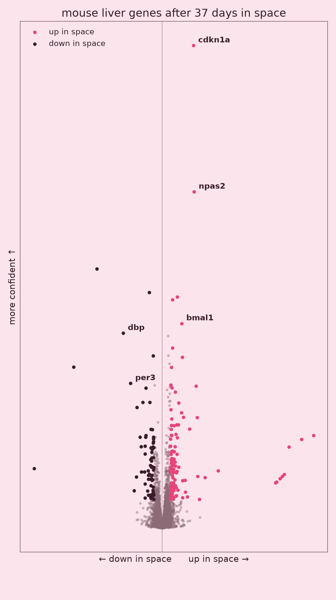
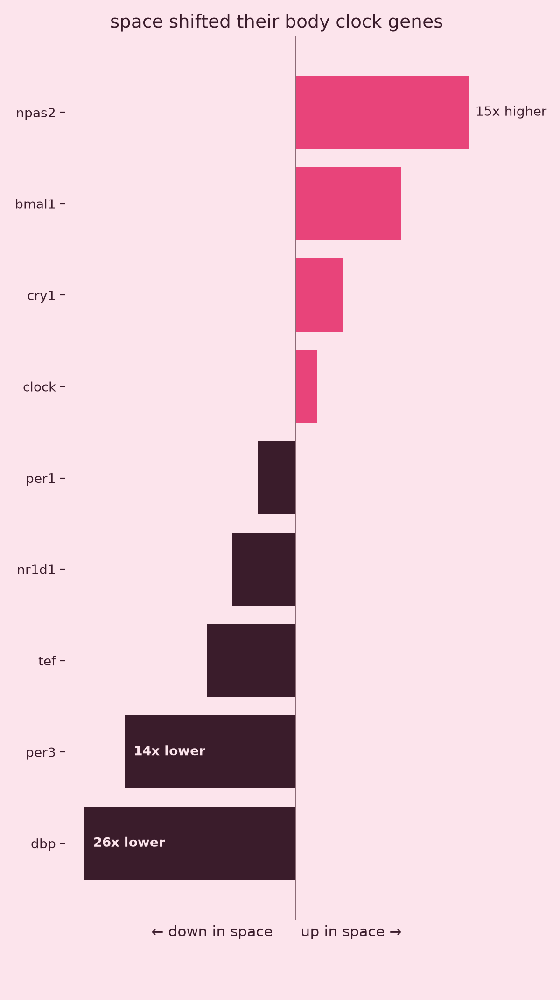
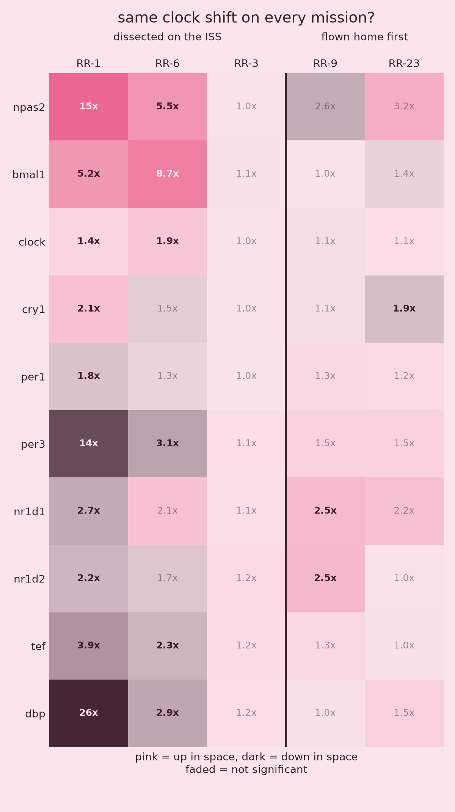
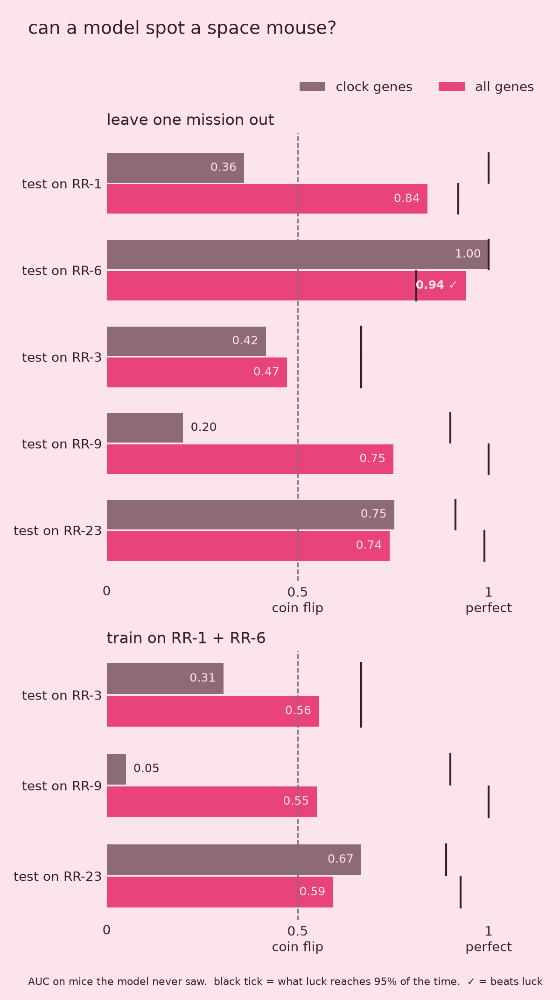

# What 37 Days in Space Did to Mouse Genes

Mice that lived on the International Space Station came back with their liver body clock shifted. I found this in public NASA data, then checked whether it happens again on four other missions. It only shows up in mice that were dissected in orbit. Finally, I trained a model to tell space mice from Earth mice and tested it honestly on missions it had never seen.

Everything here runs on free, public data from NASA's [Open Science Data Repository](https://osdr.nasa.gov/) (OSDR), in Python with pandas, matplotlib and scikit-learn.

| File | What it does |
|---|---|
| [`01_rr1_liver_analysis.ipynb`](01_rr1_liver_analysis.ipynb) [](https://colab.research.google.com/github/ashenbgy/mice-in-space/blob/main/01_rr1_liver_analysis.ipynb) | Rodent Research 1 (OSD-48): which liver genes changed after 37 days in space |
| [`02_clock_replication.ipynb`](02_clock_replication.ipynb) [](https://colab.research.google.com/github/ashenbgy/mice-in-space/blob/main/02_clock_replication.ipynb) | Runs the same comparison on four more missions to see if the clock shift repeats |
| [`03_space_mouse_classifier.ipynb`](03_space_mouse_classifier.ipynb) [](https://colab.research.google.com/github/ashenbgy/mice-in-space/blob/main/03_space_mouse_classifier.ipynb) | Machine learning: can a model tell a space mouse from an Earth mouse on a mission it has never seen? |
| [`gene_explorer.html`](gene_explorer.html) | Interactive page in English and Sinhala: switch between the five missions, search any gene, and compare it across missions |
| [`images/`](images/) | The charts below |

## Part 1: Rodent Research 1

One group of female mice lived on the ISS for 37 days. A matched group stayed on Earth in the same habitats with the same food. NASA sequenced their livers and published the flight vs. ground comparison for every gene.

- **13,263** genes tested
- **184** changed: 112 up in space, 72 down (at least 2× change, adjusted p < 0.05)
- The body clock moved. Npas2 went up **14.6×** and Bmal1 **5.2×**, both on the "wake up" side of the clock. Dbp went down **26.4×**, Per3 **14.2×** and Tef **3.9×**, all on the "wind down" side.

<p>
  
  
</p>

## Part 2: Does it replicate?

One study is one study, so I ran the same pipeline on four more Rodent Research liver studies:

| Mission | OSD | Where the mice were euthanized | RR-1's changed genes moving the same way | Clock shift? |
|---|---|---|---|---|
| RR-1 | 48 | on the ISS | (reference) | yes |
| RR-6 | 245 | on the ISS | **78%** (59 also significant) | **yes** |
| RR-3 | 137 | on the ISS | 49% | no signal; the study found 0 changed genes overall |
| RR-9 | 242 | on Earth, after splashdown | 25% | no, partly reversed |
| RR-23 | 463 | on Earth, after splashdown | 42% | no |

About 50% would be expected by chance.



The shift shows up in mice euthanized aboard the station and is gone in mice flown home alive first. Two explanations fit. The clock may reset within a few days of landing, or something about dissecting in orbit, such as the time of day, may be part of the signal. These five studies can't tell those apart. The missions also differ in strain, sex and age, and RR-9's ground controls were run a year later because of Hurricane Irma. So this is a strong clue, not proof.

## Part 3: Can a model spot a space mouse?

Next I turned the question into a machine learning one. Given only one mouse's liver gene readings, can a model tell whether that mouse went to space, even on a mission it never trained on?

- **Data:** 69 mice from the five missions, one row per mouse, 12,514 genes. I subtracted each gene's average within its own mission, so the model can't win just by recognizing which mission a mouse came from. This step uses no labels.
- **Model:** logistic regression with strong regularization, because there are far more genes than mice. One version sees only the 10 clock genes, the other sees all genes.
- **Test:** leave one mission out (train on four missions, test on the fifth), plus training only on the two missions that showed the clock shift.
- **Baseline:** shuffle the space/Earth labels and retrain 200 times, to see how high pure luck can score.



- **Only one result clearly beats luck:** all genes, tested on RR-6 (AUC 0.94, p < 0.01). RR-6 is the largest test set, with 20 mice.
- **With 9–10 test mice, luck alone reaches AUC 0.9–1.0** about 5% of the time. Without the shuffle baseline, AUC 0.75 on RR-9 and RR-23 would have looked like success.
- **The clock model trained on the in-orbit missions scores 0.05 on RR-9,** so it gets those mice almost perfectly backwards. This matches the reversed clock pattern from Part 2.

So the honest conclusion is that 69 mice across five different missions isn't enough to build a space-mouse detector that works on new missions. The model works on RR-6, and the shuffle baseline shows why most of the other scores can't be trusted.

## Things that nearly fooled me

**The comparison pointed backwards.** NASA's columns are written as `(Group A)v(Group B)`, and in OSD-48 the ground group comes first. So a positive number meant *higher on Earth*. My first charts had every color backwards. Both notebooks now read the column name and flip the sign, so positive always means higher in space. Cell 4 of the first notebook checks this against the raw group averages for Npas2.

**Some genes look impossibly huge.** Ucp1 shows up as over 300,000× higher in space. Ucp1 is a fat gene. Several other genes near the top of the list are muscle and skin genes, which normally don't appear in liver. The likely cause is a trace of neighboring tissue getting into some samples during dissection. When a gene starts near zero, even a trace makes the fold change explode. I left these out of the story, and the gene explorer flags genes like this with a warning.

**Small test sets flatter models.** A test mission with 9 mice can score AUC 0.9 by luck. That's why every result in Part 3 is compared against 200 shuffled-label runs instead of 0.5.

**Timing matters for clock genes.** The replication made this concrete: the shift depends on when and where the mice were dissected. So the honest claim is "body clock genes shifted in mice dissected in orbit", not "space broke their body clock".

## Run it yourself

Click an **Open in Colab** badge above and run the cells top to bottom. Nothing to install. To run locally instead:

```bash
pip install pandas numpy matplotlib requests scikit-learn jupyter
jupyter notebook
```

The notebooks download the data straight from NASA's API, about 35 MB per study. To open the gene explorer, double-click `gene_explorer.html`. It works offline because the data is built into the page.

## Data

NASA Space Biology Open Science Data Repository (OSDR), studies OSD-48, OSD-245, OSD-137, OSD-242 and OSD-463, GeneLab processed RNA-seq differential expression. Accessed 2026-10-26 from https://registry.opendata.aws/nasa-osdr. The data is public domain.
